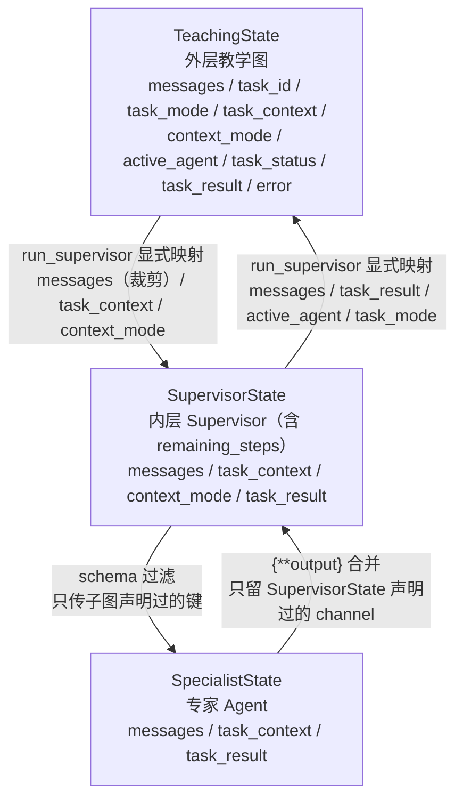
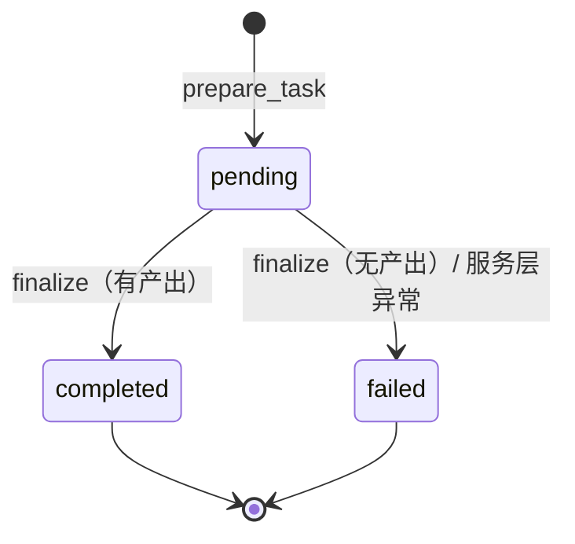
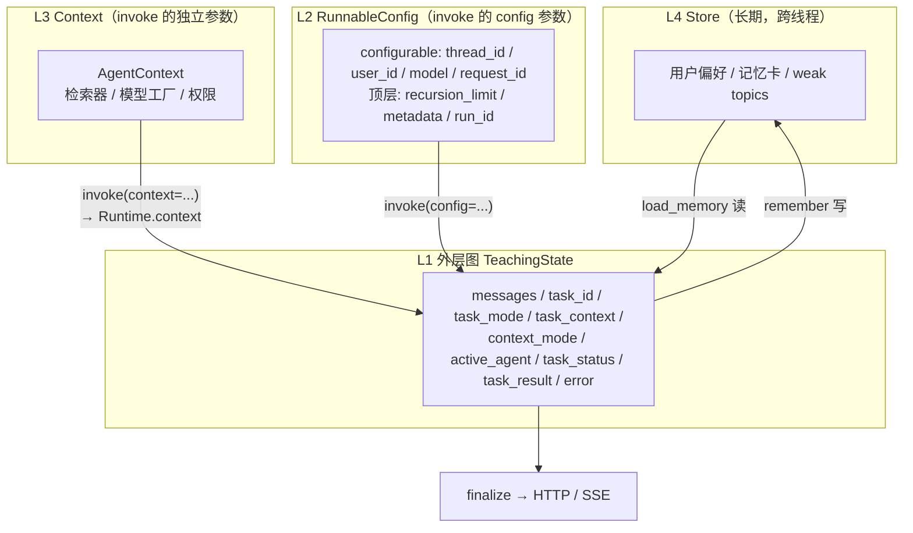

# EDU-Agent State 设计方案

> 状态：**v5.1（2026-11-06 审核通过；MVP M1–M3 已实施，见 §12.3）**
> 修订日期：2026-11-06
> 实施入口：**§〇「论文实现范围（MVP）」+ §12.1「MVP 三步」**
> 图例：**【MVP】** 本轮实现；**【暂缓】** 方案保留，论文中列为未来工作
> 适用范围：外层教学图（Supervisor + knowledge/question/grading 三个专家 Agent）
> 相关体系：提示词三层架构（第1层字符串 Prompt / 第2层 ChatPromptTemplate / 第3层 Agent 节点）

## 修订摘要

### v5（本轮）

| # | v4 的问题 | v5 的修正 |
|---|-----------|----------|
| 1 | 一张 `EduAgentState` 同时当外层图 State 和 Supervisor 图 State | **拆成三张 Schema**：`TeachingState` / `SupervisorState` / `SpecialistState`，各归各图（§二） |
| 2 | 外层 State 继承 `AgentState`，白拿 `remaining_steps` | **`TeachingState` 是普通 TypedDict**，不继承；`remaining_steps` 只出现在 `SupervisorState`（§2.2） |
| 3 | `task_status` 混用"图执行到哪"和"业务成没成" | 定义为**业务任务结果**；图执行状态从 `state.next` / `state.tasks` / stream 读（§5.1） |
| 4 | "每次 invoke = 新任务"没有幂等设计，重试会建重复任务、追加重复用户消息 | 新增 `request_id` → 稳定 `task_id` + 稳定 `HumanMessage.id`；重试走 replay / retry（§5.3） |
| 5 | `task_result: dict[str, Any]` 过宽 | 收窄成**带 `kind` 标签的 TypedDict 联合**，只允许 `grading` / `question_set`（§4.4） |
| 6 | `TaskError.stage` 只有三个值，覆盖不了实际出错点 | 补成六个阶段，并说明 `specialist` 阶段怎么贯通到服务层（§4.5） |
| 7 | L2/L3 数据流图画成 L3 → L2 → L1，`recursion_limit` 位置仍在 `configurable` | `context` 是 `invoke` 的**独立关键字参数**，不经过 `RunnableConfig`；`recursion_limit` 是 `RunnableConfig` 顶层键（§1.2 / §八） |

### v5.1（本轮复审）

| # | v5 的问题 | v5.1 的修正 |
|---|-----------|------------|
| 1 | `task_mode` 单纯按专家名推断，专家名表达不了完整业务类型 | **三级判定**：`task_result.kind`（权威）→ 专家名（best-effort）→ 直答/未知；抽成独立函数 `infer_execution()`（§4.1） |
| 2 | "无专家消息"被当成 supervisor 直答 | **区分三种情况**：`tail is None` → `unknown`；`tail.name is None` → `chat`；未注册专家名 → `unknown`；**异常不调用推断**（§4.1 边界表） |
| 3 | `task_mode` 隐含依赖 `active_agent` | 两个字段在同一函数内**分别计算**，`task_mode` 不由 `active_agent` 推导（§4.1） |
| 4 | L2 把 `recursion_limit` / `metadata` / `run_id` 混为一类 | 标注两类用途：**调度控制**（`recursion_limit`）与**追踪元数据**（`metadata` / `run_id`，不参与业务判断）（§1.2） |
| 5 | `task_context` 的"读旧值—合并—返回完整值"只写在说明里 | 升级为**代码规范硬规则**，明令禁止返回局部 patch（§6.2） |
| 6 | `_mark_failed` 只判 `task_status`，并发下会误伤另一个请求 | 增加 **`task_id` 并发守卫**：`values["task_id"] != current_task_id` 时直接返回（§5.4） |

### v4（上一轮，保留）

- 两条边界重写：外层图 ↔ supervisor 是**函数调用**，supervisor ↔ 专家是 **schema 过滤 + `{**output}` 合并**；`create_supervisor` 没有 `input_mapping` / `output_mapping`。
- v1 不做 `resume_task`（全仓无 `interrupt()`）。
- `task_mode`（业务词表）与 `context_mode`（检索词表）彻底分开。
- `active_agent` 初始化为 `None`，`"supervisor"` 不是合法值。
- `task_context` 不挂 reducer 时是**整值覆盖**，浅合并必须由节点自己算。
- `failed` 写入前先判终态，绝不覆盖 `completed`。

---

## 〇、文档范围：这是 state 的设计方案，不是系统全设计

本文档只回答一个问题：**谁在什么生命周期里持有哪些字段、怎么流转、谁写谁读。**

### 已覆盖

| 主题 | 章节 |
|------|------|
| 四层职责与硬边界（L1~L4） | §一 |
| 三张 Schema（外层 / Supervisor / 专家） | §二 |
| 两条边界的映射（函数调用 / schema 过滤） | §三 |
| 字段定义、类型、值域 | §四 |
| 任务生命周期、幂等、失败写入 | §五 |
| `task_context` 更新与写入约束 | §六 |
| Checkpointer 兼容、并发边界 | §七 |
| 数据流图 | §八 |
| 可观测性归属 | §九 |
| 与提示词三层的关系 | §十 |
| 代码映射与实施顺序 | §十一 / §十二 |

### 故意不在范围内

| 主题 | 去哪看 |
|------|--------|
| 检索链内部状态（pipeline / RRF / rerank） | `docs/ARCHITECTURE_RETRIEVAL.md` |
| Memory 的存储与 schema（Store / 记忆卡） | `docs/KB_MASTER_DESIGN.md`、`src/memory/` |
| 提示词内容与模板 | `src/prompts/` |
| API 的完整契约（本文档只改 `request_id`） | `src/service/`、`src/schema/` |
| 容器与部署 | `docs/DOCKER.md` |

### 待补：属于 state 范畴、但本文档尚未写

| # | 缺口 | 影响 |
|---|------|------|
| 1 | `load_memory` 节点的契约（读写哪些字段、记忆卡固定 ID、与 `prepare_task` 的顺序与幂等交互） | 实现时容易与 `prepare_task` 重复分类 |
| 2 | `task_id` 在 tracing metadata 中的传播（`prepare_task` 生成晚于 `RunnableConfig` 构造） | LangSmith 里无法按任务聚合 |
| 3 | `/history`、`/threads` 的读取契约（当前只读 `messages`，新字段是否要暴露） | 前端拿不到任务结果 |
| 4 | 直接寻址 agent 的接口（目前只注册 `edu-assistant`，但 `/{agent_id}/...` 形态存在） | 将来注册专家时没有任务生命周期 |
| 5 | `TaskError.recoverable` 的消费方（当前全仓无人读） | 字段目前是装饰性的 |
| 6 | `task_eval` / 检索门禁的回归清单 | state 改造后没有自动兜底 |
| 7 | 回滚方案（旧 checkpoint 遇到新代码、新 checkpoint 回旧代码） | 上线出问题时无退路 |

> 这 7 项**不影响 state 的核心设计**，但会让实现和验收留下空白。
> 是否补写，见评审结论。

### 论文实现范围（MVP）

> 图例：**【MVP】** 本轮实现；**【暂缓】** 方案保留、不入本轮实现（论文中列为未来工作）。

| 设计项 | 状态 | 说明 |
|--------|------|------|
| `TeachingState` + `SupervisorState` 两张 Schema | **MVP** | 库硬约束 + 职责分离（§二） |
| `SpecialistState` | 暂缓 | 只在需要向专家传 `task_context` / `task_result` 时才需要 |
| `prepare_task` / `finalize` + `task_status` 三态 | **MVP** | 生命周期显式化（§五） |
| `run_supervisor` 白名单映射 | **MVP** | 边界 A 的唯一实现点（§3.2） |
| `infer_execution()`（`active_agent` / `task_mode`） | **MVP** | 约 20 行（§4.1） |
| `task_id`（服务端生成）+ `_mark_failed` 双守卫 | **MVP** | 不依赖客户端幂等键（§5.4） |
| `context_mode` 迁移、删除 `_THREAD_MODE` | **MVP** | 修真实 bug（§11.1） |
| `task_context` 三步合并规则 | **MVP** | 防字段静默丢失（§6.2） |
| 旧 checkpoint 兼容 | **MVP** | 演示不炸（§7.2） |
| `request_id` 幂等 / replay / retry | 暂缓 | 单机演示无网关重试（§5.3） |
| `task_result` + 三层 schema 耦合 | 暂缓 | 改工具契约 + P0 风险；仓库已有专用 API（§4.6） |
| `ErrorStage` 六段 | MVP **降为三段** | 只保留 `prepare` / `supervisor` / `finalize`（§4.5） |
| 同 thread 并发锁 | 暂缓 | 单用户演示（§7.3） |
| 回滚方案 | 暂缓 | 写未来工作 |
| L3 `context_schema` | 暂缓 | 当前无消费者：`get_model` 是模块级缓存、`get_store` 是模块级单例（§1.2） |
| `/history` 暴露新字段、直接寻址 agent | 暂缓 | 不影响核心链路 |

**MVP 三步：**

1. 两张 Schema + `prepare_task` / `finalize` + `task_status` 三态；
2. `run_supervisor` 白名单搬运 + `infer_execution()`；
3. 删 `_THREAD_MODE`、`context_mode` 迁入 State，跑旧 thread 回归。

> 暂缓项的**方案论证保留**：论文写"设计与实现"章时说明已完成设计、未纳入本轮实现，
> 比删掉这些章节更能体现思考深度。

---

## 一、设计原则：四层互不替代

| 层级 | 名称 | 核心职责 | 生命周期 | 承载机制 | 典型内容 |
|------|------|---------|---------|---------|---------|
| **L1** | **Graph State** | 图执行的状态容器，各 Node 读取、修改、传递数据 | 见 §4（逐字段） | `TeachingState` + Checkpointer | `messages`, `task_id`, `task_mode`, `task_context`, `task_status`, `task_result`, `error` |
| **L2** | **RunnableConfig** | 线程、用户、模型、运行限制等**调度配置** | 单次 API 请求 | `RunnableConfig`（**顶层键** + `configurable` 子字典） | `configurable`（业务调度）：`thread_id` / `user_id` / `model` / `request_id`；顶层**调度控制**：`recursion_limit`；顶层**追踪元数据**：`metadata` / `run_id`（不参与任何业务判断） |
| **L3** | **Runtime Context** | 本次运行期间相对稳定的执行依赖 | 本次运行期 | **`context_schema`（编译期）+ `invoke(context=...)`（运行期）** | 检索器、模型工厂、权限、外部服务句柄 |
| **L4** | **Store** | 跨对话、跨线程的持久化长期记忆 | 长期 | `BaseStore`（`store.db`） | 用户学习偏好、长期记忆卡、weak topics |

### 1.1 四层不互相替代的硬边界

- `TeachingState` **不写** `thread_id` / `user_id` / `request_id` —— L2 的职责。
- `TeachingState` **不写** 长期记忆 —— L4 的职责（记忆卡以 SystemMessage 进入 `messages`，记忆本体仍留在 Store）。
- `TeachingState` **不写** 用户权限 / 模型实例 / 检索器 —— L3 的职责。
- `RunnableConfig` **不写** `task_status` 等业务字段 —— L1 的职责。
- `remaining_steps` **不进外层 State** —— 它是内层 ReAct 的托管值，见 §2.2。

### 1.2 L2 与 L3：两个**并列**的 invoke 参数（v5 修正）

这是 v4 画错的地方。实际调用是：

```python
agent.ainvoke(
    input,                 # L1 初始 state
    config=config,         # L2：configurable + recursion_limit / metadata / run_id
    context=ctx,           # L3：独立关键字参数，不在 config 里
)
```

节点内部这样读：

```python
from langgraph.runtime import Runtime

async def node(state: TeachingState, runtime: Runtime[AgentContext]) -> dict:
    retriever = runtime.context.retriever   # L3
    store = runtime.store                   # L4（Runtime 也透出 store）
```

| 事实 | 结论 |
|------|------|
| `context` 是 `invoke` / `astream` 的独立关键字参数（已实测签名） | L3 **不经过** L2，图里没有 `L3 → L2` 这条边 |
| `context_schema=` 在 `create_supervisor` / `create_agent` **装配期**传入 | 它只声明形状；值在每次 invoke 时给 |
| `recursion_limit` 是 `RunnableConfig` 的**顶层键** | 不在 `configurable` 里；`service.py:216-225` 就是这么构造的 |
| `Runtime` 还提供 `store` / `stream_writer` / `previous` | L4 和流式输出都有原生入口，不用自己绕 |

**L2 / L3 的分界线：**

> 换一个值，是否算"另一次运行"？是 → L2；否 → L3。

| 例子 | 归属 |
|------|------|
| `thread_id` / `user_id` / `request_id` | L2 · `configurable`（业务调度） |
| `model`（用户临时指定） | L2 · `configurable`（业务调度） |
| `recursion_limit` | L2 · 顶层（**调度控制**，参与运行限制计算） |
| `metadata` / `run_id` | L2 · 顶层（**追踪元数据**，只给日志 / LangSmith 用，**不参与业务判断**） |
| 检索器 / Store 句柄 / 模型工厂 | L3 |
| 用户权限（只读 / 可写） | L3 |
| 长期记忆卡内容 | L4 |

> `recursion_limit` 与 `metadata` / `run_id` 虽然同在顶层，但**用途不同**：
> 前者是调度控制，会被框架读取并实际影响执行（超限即中止）；
> 后者是追踪元数据，框架只透传不解释。不要把它们统称为"业务配置"。

> **【暂缓】本轮不引入 `context_schema`**：当前 `get_model()` 走模块级缓存（`core/llm.py`），
> `get_store()` 是模块级单例（`memory/runtime.py`），节点没有运行时注入需求。
> L3 这一层保留在模型中，但 MVP 不实现。

---

## 二、三张 Schema：各归各图（v5 核心修正）【MVP：两张；`SpecialistState` 暂缓】

### 2.1 为什么不能共用一张

v4 把 `EduAgentState` 同时传给外层 `StateGraph` 和 `create_supervisor(state_schema=...)`，带来三个具体问题：

1. **职责泄漏**：Supervisor 的 ReAct 节点会带着 `task_id` / `task_status` / `error` 一起流转，但这些字段它既不读也不该写。
2. **结构耦合**：外层图被迫接受 `remaining_steps` 这个只服务 ReAct 循环的托管 channel。
3. **改动半径**：想给外层加一个字段，就得同时确认 Supervisor 的 schema 兼容，反之亦然。

三张 Schema 的边界：

| Schema | 所属图 | 基类 | 必须有的 channel | 只在这里出现的字段 |
|--------|--------|------|-----------------|-------------------|
| `TeachingState` | 外层教学图 | **普通 `TypedDict`** | `messages` | `task_id` / `task_mode` / `task_status` / `task_result` / `error` / `active_agent` |
| `SupervisorState` | 内层 Supervisor | `langgraph.prebuilt.chat_agent_executor.AgentState` | `messages` + `remaining_steps` | `task_context` / `context_mode` / `task_result`（透传用） |
| `SpecialistState` | 专家 Agent 子图 | `langchain.agents.AgentState` | `messages`（+ `jump_to` / `structured_response`） | `task_context` / `task_result`（工具读写用） |

> **为什么 `SupervisorState` 必须继承 prebuilt `AgentState`**：`create_supervisor` 内部调 `create_react_agent`，
> 构造期硬校验 schema 必须含 `messages` 与 `remaining_steps`
> （`.venv/.../langgraph/prebuilt/chat_agent_executor.py:538-545`），否则直接
> `ValueError: Missing required key(s) {'remaining_steps'} in state_schema`（已实测复现）。
> `langchain.agents.AgentState` 没有 `remaining_steps`，不能拿来当 supervisor 的基类。

### 2.2 `TeachingState` 不继承 `AgentState`

外层图是普通 `StateGraph`，节点是自己写的函数，没有 ReAct 循环，**不需要 `remaining_steps`、`jump_to`、`structured_response`**。
继承 `AgentState` 等于白拿三个用不上的 channel，还让外层图与 LangChain 的 agent 抽象耦合。

```python
class TeachingState(TypedDict):
    messages: Annotated[list[AnyMessage], add_messages]
    task_id: NotRequired[str]
    task_mode: NotRequired[TaskKind]
    task_context: NotRequired[dict[str, Any]]
    context_mode: NotRequired[RetrievalMode | None]
    active_agent: NotRequired[str | None]
    task_status: NotRequired[TaskStatus]
    task_result: NotRequired[TaskResult | None]
    error: NotRequired[TaskError | None]
```

### 2.3 三张 Schema 的定义 【MVP 只定义前两张】

> `SpecialistState` 与下面的 `task_result` 绑定：不做结构化结果回传，就不需要给专家扩展 schema。
> MVP 阶段专家继续用 `langchain.agents.AgentState`，不改 `build_agent`。

```python
# src/agents/state.py
from typing import Annotated, Any, Literal, NotRequired, TypedDict

from langchain.agents import AgentState as SpecialistBase          # messages / jump_to / structured_response
from langchain_core.messages import AnyMessage
from langgraph.graph.message import add_messages
from langgraph.prebuilt.chat_agent_executor import AgentState as SupervisorBase  # messages / remaining_steps

from schema.task_policy import TaskMode as RetrievalMode           # 检索词表（不是业务词表）


# ── 词表 ─────────────────────────────────────────────────────────────
TaskKind = Literal["chat", "question", "grading", "knowledge", "unknown"]   # 业务词表
TaskStatus = Literal["pending", "completed", "failed"]                     # 业务结果，不是图状态
ErrorStage = Literal[
    "prepare", "memory", "supervisor", "specialist", "finalize", "service",
]  # MVP 只实现 prepare / supervisor / finalize，其余见 §12.2


# ── 业务类型 ─────────────────────────────────────────────────────────
class TaskError(TypedDict):
    code: str
    message: str
    stage: ErrorStage
    recoverable: bool


class GradingTaskResult(TypedDict):
    kind: Literal["grading"]
    grading: dict[str, Any]        # GradingResult.model_dump()


class QuestionTaskResult(TypedDict):
    kind: Literal["question_set"]
    question_set: dict[str, Any]   # GeneratedQuestionSet.model_dump()


TaskResult = GradingTaskResult | QuestionTaskResult


# ── L1：外层教学图（普通 TypedDict，不继承 AgentState）──────────────
class TeachingState(TypedDict):
    messages: Annotated[list[AnyMessage], add_messages]
    task_id: NotRequired[str]
    task_mode: NotRequired[TaskKind]
    task_context: NotRequired[dict[str, Any]]
    context_mode: NotRequired[RetrievalMode | None]
    active_agent: NotRequired[str | None]
    task_status: NotRequired[TaskStatus]
    task_result: NotRequired[TaskResult | None]
    error: NotRequired[TaskError | None]


# ── 内层 Supervisor（继承 prebuilt AgentState，含 remaining_steps）──
class SupervisorState(SupervisorBase):
    task_context: NotRequired[dict[str, Any]]
    context_mode: NotRequired[RetrievalMode | None]
    task_result: NotRequired[TaskResult | None]   # 专家写入后，这里要能接住


# ── 专家（继承 langchain AgentState，按需扩展）──────────────────────
class SpecialistState(SpecialistBase):
    task_context: NotRequired[dict[str, Any]]
    task_result: NotRequired[TaskResult | None]
```

### 2.4 三张 Schema 的字段总表

| 字段 | `TeachingState` | `SupervisorState` | `SpecialistState` | 说明 |
|------|:---:|:---:|:---:|------|
| `messages` | ✅ | ✅ | ✅ | 三张都有，但**不是同一份**：边界 A 传副本，边界 B 过滤 |
| `remaining_steps` | ❌ | ✅（继承） | ❌ | 只服务 ReAct 循环 |
| `jump_to` / `structured_response` | ❌ | ❌ | ✅（继承） | langchain agent 内部用 |
| `task_id` | ✅ | ❌ | ❌ | 只用于外层日志 |
| `task_mode` | ✅ | ❌ | ❌ | 业务类型，事后推断 |
| `task_status` | ✅ | ❌ | ❌ | 内层不参与生命周期 |
| `task_result` | ✅ | ✅ | ✅ | 必须三层都在，才能从工具一路冒到 HTTP 响应 |
| `error` | ✅ | ❌ | ❌ | 只在外层记录 |
| `active_agent` | ✅ | ❌ | ❌ | 由 `run_supervisor` 事后推断 |
| `task_context` | ✅ | ✅ | ✅ | 工具/中间件要读，三层都要声明 |
| `context_mode` | ✅ | ✅ | 按需 | 检索策略；专家侧只在需要时声明 |

> ⚠️ **`task_result` 的三层耦合是硬约束**：工具写在 `SpecialistState`，`{**output}` 合并进 `SupervisorState`，
> `run_supervisor` 再返回进 `TeachingState`。**少一层就在那一层被静默丢弃**（§4.6）。

---

## 三、两条边界与数据映射

### 3.1 实际调用链

```
HTTP POST /invoke
  └─ service._handle_input                      # 构造 RunnableConfig + context + 初始 input
      └─ edu_supervisor.ainvoke                 # 外层图 TeachingState（有 checkpointer）
          ├─ prepare_task                       # 任务初始化 / 幂等判定
          ├─ load_memory                        # 读 L4 Store → 固定 ID 的 SystemMessage
          ├─ run_supervisor                     # ★ 普通节点：函数调用内层图
          │   └─ inner_supervisor.ainvoke(...)  # 内层 SupervisorState（无 checkpointer）
          │       ├─ supervisor  (ReAct 节点)
          │       ├─ knowledge_agent / question_agent / grading_agent  # SpecialistState 子图
          │       └─ forward_after_agent        # pre_model_hook：专家终答时短路到 END
          └─ finalize                           # 业务结果收尾
```

| 环节 | 位置 |
|------|------|
| 外层图装配 | `src/agents/teaching_graph.py:177` |
| 外层节点 `run_supervisor` | `src/agents/teaching_graph.py:167` |
| 内层 supervisor 装配 | `src/agents/supervisor.py:180` |
| 专家终答短路 | `src/agents/supervisor.py:103` |
| 服务层入口 | `src/service/service.py:196` |

### 3.2 边界 A：`TeachingState` ↔ `SupervisorState` —— 普通函数调用

`run_supervisor` 不是子图节点，是普通节点里的 `ainvoke`。这条边界**没有 channel 合并、没有 reducer、没有自动透传**：

```python
_INBOUND_KEYS = ("task_context", "context_mode")     # TeachingState → SupervisorState
_OUTBOUND_KEYS = ("task_result",)                    # SupervisorState → TeachingState


async def run_supervisor(state: TeachingState, config=None) -> dict:
    trimmed = trim_conversation(
        state.get("messages") or [],
        max_messages=settings.MEMORY_HISTORY_MAX_MESSAGES,
    )
    payload = {"messages": trimmed}
    payload.update({k: state[k] for k in _INBOUND_KEYS if k in state})

    result = await inner_supervisor.ainvoke(payload, config=config)
    if not isinstance(result, dict):
        return {}

    # active_agent / task_mode 在这里事后推断（独立计算，见 §4.1）
    inferred = infer_execution(
        result.get("messages") or [],
        task_result=result.get("task_result"),
        run_ok=True,                      # 异常路径根本走不到这里（见下）
    )

    return {
        "messages": result.get("messages") or [],
        **inferred,
        **{k: result[k] for k in _OUTBOUND_KEYS if k in result},
    }
```

> **异常路径不调用 `infer_execution`**：`ainvoke` 抛错时 `run_supervisor` 直接把异常包上
> `stage` 再抛出，`task_mode` 保持 `prepare_task` 写入的 `"unknown"`。
> 绝不能在 `except` 里调一次推断——那会把失败误判成 `chat`（§4.1 的边界表）。

| `TeachingState` 字段 | 传进 `SupervisorState` | 理由 |
|----------------------|:---:|------|
| `messages` | ✅（**裁剪后**） | 只裁剪送入模型的部分，checkpoint 仍保留完整历史 |
| `task_context` | ✅ | 供内层中间件 / 工具读取 |
| `context_mode` | ✅ | ContextVar 未必跨嵌套图传播，state 里留一份兜底（§11.2） |
| `task_id` | ❌ | 只用于外层日志 |
| `task_mode` | ❌ | 路由发生前它还是 `unknown`，传进去无意义 |
| `task_status` | ❌ | 内层不参与生命周期 |
| `active_agent` | ❌ | 内层产出后由外层推断 |
| `task_result` | ❌（入） | 新任务开始时就是 `None` |
| `error` | ❌ | 入口已重置 |

> **白名单而不是黑名单**：新增字段时更容易发现"忘了转发"，也天然避免把外层字段泄进内层。

### 3.3 边界 B：`SupervisorState` ↔ `SpecialistState` —— schema 过滤 + 输出合并

内层图里专家是真正的子图节点，`langgraph-supervisor` 用 `_make_call_agent` 包了一层：

```python
# langgraph_supervisor/supervisor.py:77-127（库源码，节选）
def call_agent(state: dict, config: RunnableConfig) -> dict:
    output = agent.invoke(state, config)     # 整个 SupervisorState 交给专家
    return _process_output(output)

def _process_output(output: dict) -> dict:
    ...
    return {**output, "messages": messages}  # 专家输出全部键原样合并回去
```

1. **进入专家**：整个 `SupervisorState` 被传入，`SpecialistState` 的 input schema 过滤掉不认识的键。
2. **离开专家**：`{**output}` 合并回 `SupervisorState`，只有其 schema 声明过的 channel 才留得下。
3. **没有 `input_mapping` / `output_mapping`**——该版本没有这两个参数，控制手段只有 schema。

| 字段 | 专家默认收到？ | 要收到需要做什么 |
|------|:---:|------|
| `messages` | ✅ | 默认基类已含 |
| `task_context` | ❌ | `build_agent(..., state_schema=SpecialistState)` |
| `task_result` | ❌ | 同上（工具要写它时必须声明，§4.6） |
| `task_id` / `task_mode` / `task_status` | ❌ | 不传，也不需要 |

> ⚠️ **"state 里能看到" ≠ "模型能看到"**。`create_agent` 的 `system_prompt` 是静态字符串。
> 要让专家 LLM 读到 `task_context`，只有三条路：
> ① supervisor 在 handoff 的 `task_description` 里复述（现状）；
> ② 专家侧加 `before_model` 中间件注入 SystemMessage；
> ③ 工具用 `InjectedState` 读（LLM 看不到，但工具能用）。
> **v4/v5 推荐 ① + ③**，不改专家提示词。

### 3.4 三张 Schema 的数据流



### 3.5 已固定、设计必须迁就的库行为

| 设置 | 值 | 后果 |
|------|-----|------|
| `output_mode` | `"last_message"` | 专家中间消息不回传；只保留最后一条（末条是 ToolMessage 时保留两条） |
| `add_handoff_messages` | `False` | `transfer_to_*` 的控制消息不写入历史 |
| `add_handoff_back_messages` | `False` | 不回插"交还控制权"消息 |
| `forward_after_agent` | 专家终答时 `Command(PARENT, goto=END)` | **绕过 supervisor 图内下游节点**；出口节点只能放外层图 |

> `{**output}` 里的 `task_result` 是**最后一次**写入值：同一轮多次调用专家时 last-write-wins。

---

## 四、字段定义

以下字段**只在外层图**使用。完整执行轨迹不进 State（交给 LangSmith / 日志）。

### 4.1 `TeachingState` 字段

| 字段 | 类型 | 用途 | 生命周期 | 写入者 | 读取方 |
|------|------|------|---------|--------|--------|
| `messages` | `Annotated[list[AnyMessage], add_messages]` | 对话主线 | 对话线程 | 各节点追加 | 全部 |
| `task_id` | `str` | 业务任务标识 | 单次业务任务 | `prepare_task` | 日志 / tracing |
| `task_mode` | `TaskKind` | **业务**任务类型 | 单次业务任务 | `run_supervisor` 事后推断（`task_result.kind` 优先 → 专家名 → 直答 / `unknown`）；入口置 `unknown` | 出口节点 / 日志 |
| `active_agent` | `str \| None` | 最近执行过的**专家**名 | 单次业务任务 | `run_supervisor` | 日志 / 诊断 |
| `task_context` | `dict[str, Any]` | 结构化业务上下文 | 单次业务任务 | `prepare_task` 重置；授权节点合并 | 工具 / 出口节点 |
| `context_mode` | `RetrievalMode \| None` | 多轮检索意图 | **对话线程**（不随任务重置） | `prepare_task` | 检索分类 / 工具 |
| `task_status` | `TaskStatus` | **业务结果**（不是图状态） | 单次业务任务 | 见 §5.7 | 出口节点 / 服务层 |
| `task_result` | `TaskResult \| None` | 结构化业务结果 | 单次业务任务 | 专家工具（`Command`） | 出口节点 / HTTP 响应 |
| `error` | `TaskError \| None` | 错误信息 | 单次业务任务 | 服务层 / `finalize` | 出口节点 / HTTP 响应 |

**`active_agent` 的值域**：`knowledge_agent` / `question_agent` / `grading_agent` / `None`。
`None` 表示本轮**没有可识别的专家执行**——可能 supervisor 直答、可能是未注册的专家名、
也可能压根没有 AI 消息。**具体是哪种由 `task_mode` 区分**，不要用 `None` 本身表达原因。
`"supervisor"` 永远不是合法值。

**`active_agent` 与 `task_mode` 同源不同义**：

- `active_agent` 只回答"**谁执行了**"；
- `task_mode` 只回答"**这是什么业务**"。

两者由同一个函数计算，但**分别计算**：`task_mode` 不通过 `active_agent` 推导，
也不写成 `task_mode = f(active_agent)`。它们今天经常相等，是因为映射恰好一对一；
一旦业务类型需要更细的粒度（比如同一个 `grading_agent` 既可能批改也可能答疑），
这种依赖就会立刻失效。

**`task_mode` 的判定是三级，不是只看专家名**：

> 专家名只能说明"谁执行了"，不能完整表达"这是什么业务任务"。
> 所以优先级是：**结构化结果 > 专家名 best-effort > 直答/未知**。

```python
_KNOWN_AGENTS = frozenset({"knowledge_agent", "question_agent", "grading_agent"})

_AGENT_HINT: dict[str, TaskKind] = {           # best-effort，仅在没有结构化结果时用
    "knowledge_agent": "knowledge",
    "question_agent": "question",
    "grading_agent": "grading",
}

_RESULT_KIND_TO_TASK: dict[str, TaskKind] = {  # 权威信号
    "grading": "grading",
    "question_set": "question",
}


class ExecutionInference(TypedDict):
    active_agent: str | None
    task_mode: TaskKind


def infer_execution(
    messages: list,
    *,
    task_result: TaskResult | None,
    run_ok: bool,
) -> ExecutionInference:
    """从一次已结束的内层运行中，独立推断 active_agent 与 task_mode。

    两个字段分别赋值，互不依赖。
    """
    tail = _last_ai_message(messages)      # 跳过尾部 ToolMessage；见下

    # ── active_agent：只认已知专家名 ─────────────────────────────
    if not run_ok or tail is None or tail.name not in _KNOWN_AGENTS:
        active_agent = None                # 异常 / 无 AI / supervisor 直答 / 未知专家
    else:
        active_agent = tail.name

    # ── task_mode：三级判定，结构化结果优先 ──────────────────────
    if not run_ok:
        task_mode: TaskKind = "unknown"    # 异常不猜，保持入口值
    elif task_result is not None:
        # 权威信号；未知 kind 不猜，归 unknown
        task_mode = _RESULT_KIND_TO_TASK.get(task_result["kind"], "unknown")
    elif tail is None:
        task_mode = "unknown"              # 正常结束但没有 AI 消息
    elif tail.name is None:
        task_mode = "chat"                 # supervisor 自己的直答
    elif tail.name in _AGENT_HINT:
        task_mode = _AGENT_HINT[tail.name] # 专家名推断（best-effort）
    else:
        task_mode = "unknown"              # 未知专家的消息

    return {"active_agent": active_agent, "task_mode": task_mode}
```

**边界情况必须按这张表处理**：

| 运行结果 | tail AI 消息 | `task_result` | `active_agent` | `task_mode` |
|---------|-------------|--------------|---------------|-------------|
| 图执行异常 | — | — | `None` | `"unknown"`（**不调用推断**，保持入口值） |
| 正常结束 | 没有 AI 消息 | 无 | `None` | `"unknown"` |
| 正常结束 | `name is None`（supervisor 直答） | 无 | `None` | `"chat"` |
| 正常结束 | `knowledge_agent` | 无 | `"knowledge_agent"` | `"knowledge"` |
| 正常结束 | `question_agent` | `question_set` | `"question_agent"` | `"question"` |
| 正常结束 | 未注册的专家名 | 无 | `None` | `"unknown"`（**不是 `chat`**） |
| 正常结束 | 任意专家 | `grading` | `tail.name`（若已注册，否则 `None`） | `"grading"`（**权威覆盖**） |

> **"无专家消息 ≠ supervisor 直答"**：
> 只有 `tail.name is None` 的 AIMessage 才是直答；
> 完全没有 AI 消息（被截断、被中断、空产出）是 `unknown`，不是 `chat`。
> 图执行异常更不能用 `chat` 兜底——那会把一次失败伪装成一次成功寒暄。

`_last_ai_message` 必须跨过尾部 ToolMessage：

```python
def _last_ai_message(messages: list):
    for m in reversed(messages):
        if isinstance(m, ToolMessage):     # output_mode="last_message" 末条可能是 ToolMessage
            continue
        return m if isinstance(m, AIMessage) else None
    return None
```

> 现成的 `supervisor._inspect_tail` 用的是同一套跨过逻辑，但它返回 `_TailInspection`
> （三个布尔判断），拿不到"具体是哪位专家"，所以这里单独实现一个取值函数。

### 4.2 `SupervisorState` 字段

只有四个业务/框架字段：

| 字段 | 类型 | 为什么在这里 |
|------|------|-------------|
| `messages` | 继承 | ReAct 循环与专家 handoff |
| `remaining_steps` | 继承（托管） | `create_react_agent` 的硬性要求 |
| `task_context` | `dict[str, Any]` | 工具/中间件要读 |
| `context_mode` | `RetrievalMode \| None` | 检索链要读 |
| `task_result` | `TaskResult \| None` | 接住专家工具的写入，交给边界 A 带回 |

### 4.3 `SpecialistState` 字段

| 字段 | 类型 | 为什么在这里 |
|------|------|-------------|
| `messages` | 继承 | 专家自己的对话 |
| `jump_to` / `structured_response` | 继承 | langchain agent 内部使用 |
| `task_context` | `dict[str, Any]` | 工具经 `InjectedState` 读取 |
| `task_result` | `TaskResult \| None` | 结构化工具写入 |

> 三个专家默认共用一个 `SpecialistState`。如果将来某个专家的字段与别人冲突，
> 再拆成 `KnowledgeState` / `QuestionState` / `GradingState`——**不要提前拆**。

### 4.4 `task_result` 的类型（v5 收窄）【暂缓】

```python
class GradingTaskResult(TypedDict):
    kind: Literal["grading"]
    grading: dict[str, Any]        # GradingResult.model_dump()


class QuestionTaskResult(TypedDict):
    kind: Literal["question_set"]
    question_set: dict[str, Any]   # GeneratedQuestionSet.model_dump()


TaskResult = GradingTaskResult | QuestionTaskResult
```

| 决策 | 内容 | 理由 |
|------|------|------|
| 只允许两种 | `grading` / `question_set` | `chat` / `knowledge` 的终答已经在 `messages` 里，复制一份会产生两个真相源 |
| 用 `kind` 标签 | 消费方 `match result["kind"]` | 判别不依赖 `task_mode`，字段自描述 |
| 存 `dict` 不存 Pydantic 实例 | `model_dump()` 后写入 | checkpoint 序列化只保证原始类型可靠；Pydantic 实例进 state 有反序列化风险 |
| 不再用 v3 的 `{mode, payload}` | `mode` 与 `kind` 合并为一个标签 | 少一层嵌套 |

> `GradingResult` / `GeneratedQuestionSet` 的字段镜像可以先写 `dict[str, Any]`，
> 等 §12 步骤 3 落地时再补成完整 TypedDict（那一步本来就要改工具契约）。

### 4.5 `TaskError.stage` 的完整范围（v5 补全）【MVP 只实现三段】

```python
ErrorStage = Literal[
    "prepare",     # prepare_task：参数/幂等判定失败
    "memory",      # load_memory：Store 读取失败
    "supervisor",  # run_supervisor：内层 supervisor 图整体失败
    "specialist",  # 专家/工具内部失败（需 run_supervisor 包装后才能区分）
    "finalize",    # finalize：没有可返回的结果
    "service",     # 服务层：响应构建等非图的失败
]
```

| stage | 谁产生 | 怎么到达服务层 |
|-------|--------|---------------|
| `prepare` / `memory` / `finalize` | 对应节点 | 节点抛错 → 服务层包装 |
| `supervisor` | `run_supervisor` | 重新抛出时包成 `SupervisorRunError(stage="supervisor")` |
| `specialist` | `run_supervisor` | 捕获到专家异常（含 `UnclosedSpecialistOutput`）时包成 `SpecialistRunError(stage="specialist")` 再抛 |
| `service` | 服务层自身 | 直接构造 |

> **MVP 只实现 `prepare` / `supervisor` / `finalize`**：`memory` / `specialist` / `service`
> 需要节点级捕获或异常包装机制，随 §12.2 后置。

> **为什么需要包装**：异常从内层图冒出来后，服务层已经分不清是 supervisor 还是专家出的错。
> `run_supervisor` 是唯一同时能看到两层的节点，由它给异常打 `stage` 标签，
> 服务层再按异常类型映射成 `TaskError.stage`。**不要让服务层猜。**

### 4.6 `task_result` 的数据源（P0 风险）【暂缓】

**现状：没有数据源。** 结构化结果在工具内部被拍平成字符串：

- `agrade_student_answer` → `return format_grading_for_chat(result)`（`tools.py:413`）
- `agenerate_practice_questions` → `return body`（`tools.py:363`）

要落地，工具改为返回 `Command`：

```python
@tool("grade_student_answer")
async def agrade_student_answer(
    ...,
    tool_call_id: Annotated[str, InjectedToolCallId],
) -> Command:
    result: GradingResult = await grade_answer(...)
    return Command(update={
        "task_result": {"kind": "grading", "grading": result.model_dump()},
        "messages": [ToolMessage(format_grading_for_chat(result), tool_call_id=tool_call_id)],
    })
```

**必须同时满足三处 schema 声明**，少一处就在那层被丢弃：

| 层 | 位置 | 声明什么 |
|---|------|---------|
| 专家子图 | `build_agent(..., state_schema=SpecialistState)` | `task_result` 能否被工具写入 |
| supervisor 图 | `create_supervisor(..., state_schema=SupervisorState)` | 能否从专家合并上来 |
| 外层图 | `StateGraph(TeachingState)` | 能否被 `run_supervisor` 返回并落 checkpoint |

> ⚠️ **实现前先做最小冒烟**：`create_agent` + 工具返回 `Command(update=...)` 在当前版本是否正常冒泡。
> 这是本方案唯一"需要先验证 API 行为"的点，排为实施第 0 步；不通则退回
> "`response_format` + `post_model_hook`" 备选。

---

## 五、任务生命周期

### 5.1 `task_status` 到底表示什么（v5 明确）

> **`task_status` 表示"这个业务任务有没有产出可返回的结果"，不表示"图执行到哪一步"。**

图执行状态 LangGraph 已经完整提供，复制进 State 只会制造第二个真相源：

| 你想知道 | 去哪里读 |
|---------|---------|
| 图下一步执行哪个节点 | `state.next` |
| 当前是否有挂起的 interrupt | `state.tasks[].interrupts` |
| 本次运行的实时事件 | `astream(stream_mode=["updates","custom"])` |
| 这个业务任务成功了吗 | **`task_status`** |
| 失败原因是什么 | **`error`** |

三个值的业务含义：

| 值 | 含义 |
|----|------|
| `pending` | 任务已创建，**还没有可返回的结果**（涵盖排队 / 执行中 / 崩溃后未收尾） |
| `completed` | 本轮产出了可返回的结果（终答消息或 `task_result`） |
| `failed` | 任务无法完成，`error` 有值 |

**`completed` 的判定必须看产出，不能只看"跑到 finalize 了"**：

```python
async def finalize(state: TeachingState, config=None) -> dict:
    has_result = state.get("task_result") is not None
    has_answer = _last_ai_text(state.get("messages") or []) != ""
    if has_result or has_answer:
        return {"task_status": "completed"}
    return {
        "task_status": "failed",
        "error": {"code": "EMPTY_RESULT", "message": "本轮没有产出可返回的结果",
                  "stage": "finalize", "recoverable": True},
    }
```

### 5.2 v1：每次 invoke 都是新任务

全仓 `grep "interrupt(" src/` = 0 命中，没有跨 invoke 的任务续跑生产者，所以 v1 不做 `resume_task`。
`task_id` 的语义是"一次用户请求 = 一个业务任务"。

但这带来一个问题：**客户端重试**。没有幂等设计的话，一次网络超时重发就会：
① 建一个新 `task_id`、② 把同一条用户消息再追加一遍、③ 重复消耗 token。

> **MVP 不解决重试问题**：只保证服务端生成的 `task_id` 可追踪、可被 `_mark_failed` 守卫使用。
> 完整幂等方案见 §5.3（暂缓）。对单机演示，重试不在演示路径上。

### 5.3 幂等性设计（v5 新增）【暂缓】

> MVP 不需要客户端幂等键，但**需要服务端生成 `task_id`**（`f"{thread_id}:{uuid4()}"`），
> 因为 `_mark_failed` 的 `task_id` 守卫依赖它（§5.4）。这不涉及 API 契约变更。

**目标**：同一个 `request_id` 在同一个 `thread_id` 上重试时，不重复建任务、不重复追加用户消息、不重复执行。

#### 5.3.1 两个稳定标识

| 标识 | 生成方式 | 作用 |
|------|---------|------|
| `request_id` | 客户端在 API 里传入；缺省时服务端 `uuid4()` | 幂等键（L2，放进 `configurable`） |
| `task_id` | `f"{thread_id}:{request_id}"` | 业务任务标识（L1） |
| `HumanMessage.id` | `f"user-{request_id}"` | **`add_messages` 按 ID 做 upsert**，重试不会追加重复消息 |

> `add_messages` 的同 ID upsert 行为在本仓库已有先例：
> `teaching_graph.py` 用固定 ID `edu_memory_card` 保证记忆卡每轮只替换不累积。

#### 5.3.2 接口变化

```python
class UserInput(BaseModel):
    ...
    request_id: str | None = None   # 客户端幂等键；不传则服务端生成
```

`_handle_input` 中：

```python
request_id = user_input.request_id or str(uuid4())
configurable = {
    "thread_id": thread_id, "user_id": user_id,
    "request_id": request_id,          # ★ 新增保留键
}
input = {"messages": [HumanMessage(content=user_input.message,
                                  id=f"user-{request_id}")]}
```

同时把 `request_id` 加进 `reserved_keys`，禁止 `agent_config` 覆盖。

#### 5.3.3 `prepare_task` 的三分支

```python
async def prepare_task(state: TeachingState, config=None) -> dict | Command:
    conf = (config or {}).get("configurable") or {}
    thread_id = str(conf.get("thread_id") or "")
    request_id = str(conf.get("request_id") or "")

    if not request_id:                       # 兜底：没走幂等路径
        incoming_id = str(uuid4())
    else:
        incoming_id = f"{thread_id}:{request_id}"

    restored_id = state.get("task_id")
    restored_status = state.get("task_status")

    # ① 同一请求、已完成 → 直接结束，沿用已有结果（不重跑、不改 messages）
    if restored_id == incoming_id and restored_status == "completed":
        return Command(goto=END)

    # ② 同一请求、failed / pending → 重试：沿用 task_id，重跑本轮
    # ③ 不同请求 → 新任务
    ctx_mode = classify_task_mode(_last_human_text(state["messages"]),
                                  context_mode=state.get("context_mode"))
    set_context_mode(ctx_mode)

    return {
        "task_id": incoming_id,
        "task_mode": "unknown",
        "task_context": {},
        "context_mode": ctx_mode,      # 线程级，不随任务重置
        "active_agent": None,
        "task_status": "pending",
        "task_result": None,
        "error": None,
    }
```

| 场景 | 恢复的 `task_id` / `task_status` | 行为 |
|------|--------------------------------|------|
| 首次调用（无记录） | `None` | 新任务 |
| 新问题（新 `request_id`） | 旧 id / `completed` | 新任务，重置任务字段 |
| 重试已完成请求 | 同 id / `completed` | **replay**：`Command(goto=END)`，返回已有结果 |
| 重试失败请求 | 同 id / `failed` | **retry**：沿用 `task_id`，重跑 |
| 重试执行中请求（并发） | 同 id / `pending` | 按 retry 处理；**并发去重不在 v1 范围**（§7.3） |

#### 5.3.4 已知边界（必须写进 API 文档）

- **同一 `request_id` 必须对应同一份内容。** 若客户端复用它发不同问题，
  同 ID 的 `HumanMessage` 会被**覆盖**，历史会出现"新问题 + 旧回答"的错位。**服务端无法检测**（除非额外存 payload hash）。
- **并发重复不防。** 两个请求同时带着同一个 `request_id` 到达，两边都读到 `pending`，
  都会执行。要防需要 per-thread 锁或 API 层 409（§7.3）。
- **不传 `request_id` 就没有幂等。** 服务端自动生成的 key 每次不同，这是刻意的：
  幂等必须由客户端显式表达，不能靠猜。
- **retry 不清理上次失败留下的部分消息。** 失败任务可能已在 checkpoint 里留下
  半截 AI / Tool 消息，重试会在这个上下文上继续。若需要**干净重试**，
  客户端应换一个新的 `request_id`（等价于新任务）——这是一个可用的逃生口，
  但会新建 `task_id` 并追加一条用户消息。

### 5.4 `failed` 怎么写

**图内节点抛异常时，它返回的 update 不会提交。** 所以不存在"错误处理节点写 `failed`"——
错误处理节点自己也得在异常路径上被调用，而异常已经打断了执行。

v1 由服务层在图调用之外写，并且**只在任务未闭环时写**：

```python
async def _mark_failed(
    agent, config, *, task_id: str | None, exc: Exception
) -> None:
    current = await agent.aget_state(config)
    values = current.values

    # ① 并发守卫：同 thread 的另一个请求可能已经改写了 State
    if task_id is not None and values.get("task_id") != task_id:
        return

    # ② 终态守卫：已闭环的任务绝不覆盖
    if values.get("task_status") in ("completed", "failed"):
        return

    await agent.aupdate_state(config, {
        "task_status": "failed",
        "error": {"code": "GRAPH_RUN_FAILED", "message": str(exc)[:500],
                  "stage": _stage_of(exc), "recoverable": False},
    })


try:
    response = await agent.ainvoke(**kwargs, stream_mode=[...])
except (asyncio.CancelledError, GeneratorExit):
    raise                           # 客户端断开 ≠ 任务失败
except Exception as exc:
    await _mark_failed(agent, config, task_id=current_task_id, exc=exc)
    raise
```

`current_task_id` 由 `_handle_input` 一并算出并返回（它已经知道 `thread_id` 与 `request_id`）：

```python
task_id = f"{thread_id}:{request_id}"      # 与 prepare_task 的算法完全一致
# MVP：request_id 由服务端 uuid4() 生成，不需要客户端传（客户端幂等键暂缓）
```

- **并发守卫（v5.1 新增）**：同一个 `thread_id` 上并发 invoke 时，`aget_state` 读到的可能是
  **另一个请求**刚写下的 State。只判 `task_status` 会把别人的 `pending` 任务标成失败。
  必须先确认 `task_id` 是本请求的；
- **终态守卫**：`finalize` 已写 `completed` 之后再因响应序列化 / SSE 发送而抛的异常不属于任务失败；
- **`prepare_task` 之前就失败**：此时 State 里的 `task_id` 还是上一个任务的 → 守卫会跳过写入。
  这是有意的取舍：宁可漏记一条失败，也不能污染别的任务；
- **`try` 只包图调用**，不包 `langchain_to_chat_message` 之类的响应构建；
- **客户端断开不算失败**：`CancelledError` / `GeneratorExit` 直接放过；
- **两条路径都要包**：`invoke`（`service.py:258`）与 `message_generator`（`service.py:295`）；
- `_stage_of(exc)` 读 §4.5 里包装过的异常类型，映射成 `supervisor` / `specialist`。

### 5.5 `task_status` 状态机

| 状态 | 唯一写入者 | 合法来源 | 备注 |
|------|-----------|---------|------|
| `pending` | `prepare_task` | —（初始 / replay 不写） | 涵盖执行中 |
| `completed` | `finalize` | `pending` | 必须校验有产出 |
| `failed` | 服务层 / `finalize` | `pending`，且 `task_id` 必须是本请求的 | **不可覆盖 `completed`**；`prepare_task` 之前失败不记录 |



> **replay 不是一次状态转移**：同 `request_id` 重试时 `prepare_task` 直接 `Command(goto=END)`，
> 不写任何字段，`task_status` 保持 `completed`（§5.3.3）。

`interrupted` **不在枚举里**：没有 `interrupt()` 就没有这个状态。

### 5.6 未来 `resume_task` 的接入点（预留，不实现）

引入 `interrupt()` 后，唯一权威判据是 LangGraph 自己：

```python
state = await agent.aget_state(config=config)
pending = [t for t in state.tasks if t.interrupts]
```

- 有 `pending` → `Command(resume=...)`，**不重置任何任务字段**；
- 无 `pending` → 正常 `prepare_task`。

`task_status` 永远不参与这个判定——它表达业务结果，不表达执行状态（§5.1）。

---

## 六、`task_context` 更新策略

### 6.1 更新策略

| 场景 | 策略 |
|------|------|
| `prepare_task` | **整体重置为 `{}`** |
| 同一任务内 | 授权节点**浅合并**（只合并一级键），未提及的键保留 |
| 显式清空某键 | 把值设为 `None` / `[]` |
| 不更新 | **省略该键** |

> v4 已删掉"`None` 表示不更新"——它与"`null` 表示清空"抢语义。

### 6.2 不挂 Reducer 时，默认是**整值覆盖**

这是最容易写错的一处：

> 节点返回 `{"task_context": {"count": 10}}` 会把整个字典替换掉，
> 原来的 `knowledge_points` **直接丢失**。

所以"未提及的键保留"必须由节点自己算：

```python
def merge_task_context(old: dict[str, Any], patch: dict[str, Any]) -> dict[str, Any]:
    return {**old, **patch}


# 节点里
return {"task_context": merge_task_context(state.get("task_context") or {}, patch)}
```

这是 `merge_task_context` 的保证，**不是 State 的保证**。

> **代码规范（硬规则）——所有 `task_context` 更新必须满足三步：**
>
> 1. 从当前 State **读完整旧值**：`old = state.get("task_context") or {}`；
> 2. 经**统一合并函数**生成完整新值：`new = merge_task_context(old, patch)`；
> 3. 向 State 返回**完整新值**：`return {"task_context": new}`。
>
> **禁止**把局部 patch 直接当 State 更新返回，例如 `return {"task_context": patch}`。
> 默认 channel 是整值覆盖，这样写会把未提到的键全部丢掉——静默、且只在多键场景复现。

### 6.3 写入权限只能靠代码约束

Reducer 只拿到 `(old, new)`，没有节点身份。所以"只有授权节点可写"是**代码约定**：

1. **单一写入口**：只暴露 `merge_task_context(old, patch)`；
2. **窄类型**：节点返回 `TaskContextPatch`，而不是任意 `dict`；
3. **评审**：PR 里检查有没有绕过写入口直接返回 `{"task_context": ...}` 的节点。

### 6.4 两种合并实现，二选一

| 方案 | 谁做合并 | 节点返回什么 | v1 |
|------|---------|-------------|-----|
| **A. 节点内合并** | `merge_task_context(old, patch)` | **完整**的新字典 | ✅ |
| B. Channel Reducer | `context_reducer(old, new)` | 只返回 patch | ❌ |

```python
# B. 若将来挂 reducer
def context_reducer(old: dict, new: dict) -> dict:
    if new == {}:          # 显式重置
        return {}
    return {**old, **new}
```

> 不要 A、B 同时用：重复合并对浅合并幂等、无害，但会掩盖写入口是否被绕过。

---

## 七、与 Checkpointer 的关系

### 7.1 字段生命周期总览

| 字段 | 生命周期 | 跨 invoke 恢复时 |
|------|---------|-----------------|
| `messages` | 对话线程 | 恢复并保留，新调用追加（同 ID 则 upsert） |
| `task_id` | 单次业务任务 | 由 `request_id` 决定：同请求沿用，新请求重新生成 |
| `task_mode` | 单次业务任务 | 重置为 `unknown` |
| `task_context` | 单次业务任务 | 重置为 `{}` |
| `context_mode` | **对话线程** | 保留；基于上一轮值 + 本轮 query 重新分类 |
| `active_agent` | 单次业务任务 | 重置为 `None` |
| `task_status` | 单次业务任务 | 重置为 `pending`（replay 除外） |
| `task_result` | 单次业务任务 | 置 `None`（replay 除外） |
| `error` | 单次业务任务 | 置 `None` |

### 7.2 旧 checkpoint 兼容

`data/sqlite/checkpoints.db` 里已有的 checkpoint 是用 `MessagesState` 写的，只有 `messages`。

- 所有业务字段 `NotRequired` → 恢复时不会 KeyError；
- `prepare_task` 无条件下发全部键 → 第一次新版本 invoke 后状态自动补齐；
- **不要清库**：兼容逻辑本身就是可讲的"状态迁移"。

```python
state = await edu_supervisor.aget_state(config)
assert "task_id" in state.values
```

### 7.3 同 thread 并发【暂缓】

两次请求同时打同一个 `thread_id`：两个 run 都读到旧状态，`add_messages` 会交错。

- **串行假设**：在 `service.py` 文档字符串里写明"单用户单线程串行提问"；
- **要支持并发**：per-`thread_id` 的 `asyncio.Lock`，或 API 层拒绝同线程并发；
- **幂等键不解决并发**：两个并发请求带同一个 `request_id` 仍会都执行（§5.3.4）。

**v1 不做并发控制，但把它写进已知边界。**

---

## 八、四层数据流（v5 修正）



**必须看出的两件事：**

1. **L3 不经过 L2**：`context=` 和 `config=` 是 `invoke` 的两个并列参数（§1.2）；
2. **L4 只与 L1 的 `load_memory` / `remember` 交互**，不参与 L2/L3。

### 各层访问权限

| 层级 | 权限 | 示例 |
|------|------|------|
| L1 | 读写（仅外层图节点） | `prepare_task` 写 `task_id`；`finalize` 写 `task_status` |
| L2 | 只读 | 节点读 `configurable.thread_id` / `request_id` |
| L3 | 只读 | 节点经 `runtime.context` 取检索器 |
| L4 | 读写（专用接口） | `load_memory` 读，写回走 `remember` |

---

## 九、可观测性约定

**`agent_trace` 不作为 State 字段。** 重试/并行时简单 `operator.add` 表达不了"一次执行 vs 多次尝试"。

| 内容 | 归属 |
|------|------|
| 完整 Agent 执行轨迹 | LangSmith / 日志 / tracing |
| State 中保留的最小信息 | `active_agent`（最近执行者）+ `task_status`（业务结果） |
| 实时进度 | `astream(stream_mode=["updates","custom"])` |
| 需要 API 展示执行过程 | 独立的简化 `agent_trace`，单独评审 |

---

## 十、与提示词三层体系的对应关系

| 提示词层级 | 对应 State 字段 | 真实关系 |
|-----------|---------------|---------|
| **第1层**：纯字符串 System Prompt | `active_agent` | 装配期静态决定，**不是运行期读 State** |
| **第2层**：ChatPromptTemplate | `task_context` | 仅在 `prompt_service` 被显式调用时生效：`grading_core` / `question_core` 用于**工具内部**，参数来自**工具入参** |
| **第3层**：Agent 节点执行 | `task_status` / `task_result` | 结构化结果由工具写入；轨迹走 tracing |

### 10.1 澄清

聊天路径的专家是 `create_agent(system_prompt=<静态字符串>)`，**不读 State**；
`build_grade_messages(question=..., student_answer=...)` 的参数来自工具调用参数（LLM 决定），
不来自 `task_context`。所以 `task_context` 服务**工具与出口节点**，不服务专家系统提示词。

### 10.2 `prompt_service` 解耦原则（现状即正确）

```
LangGraph Node（读 State）
    ↓ 提取 task_context（节点/工具内完成，prompt_service 不 import State）
prompt_service.build_xxx_messages(**explicit_params)
    ↓
ChatPromptValue → 子图 messages
```

`grading_core.py:15`、`question_core.py:44` 已经是显式传参，**无需改动**。

---

## 十一、与现有代码的映射

| 现位置 | 当前做法 | v5 改动 |
|--------|---------|---------|
| `src/agents/teaching_graph.py:177` | `StateGraph(MessagesState)` | 改 `StateGraph(TeachingState)`，新增 `prepare_task` / `finalize` |
| `src/agents/teaching_graph.py:167` | 只传/只返回 `messages` | 按 §3.2 白名单显式搬运 |
| `src/agents/supervisor.py:180` | `create_supervisor(...)` 无 `state_schema` | 加 `state_schema=SupervisorState`（**继承 prebuilt `AgentState`**） |
| `src/agents/factory.py:42` | 无 `state_schema` / `context_schema` | 加 `state_schema=SpecialistState`；L3 走 `context_schema=AgentContext` |
| `src/agents/tools.py:363` / `:413` | 工具返回字符串 | 改 `Command(update={...})`（先冒烟，§4.6） |
| `src/agents/task_context.py:77` `_THREAD_MODE` | 进程级 dict，无界，重启丢失 | **移除**；迁入 `TeachingState.context_mode`（线程生命周期） |
| `src/service/service.py:196` | 构造 `{"messages": [...]}`，返回 `(kwargs, run_id)` | 加 `request_id` 保留键；HumanMessage 用稳定 ID；额外返回 `task_id` 供 `_mark_failed` 守卫（§5.3 / §5.4） |
| `src/service/service.py:258` / `:295` | 异常直接 500 / yield error | 先 `aget_state` 判终态，再写 `failed`（§5.4） |
| `src/schema/schema.py` `UserInput` | 无幂等字段 | 加 `request_id: str \| None` |
| LangSmith / 日志 | 逐节点手工记录 | 承接完整执行轨迹 |

### 11.1 `_THREAD_MODE` 迁移的注意事项

`_THREAD_MODE` 是当前最该被 State 接管的状态：

- 无界：`thread_id → mode` 只进不出；
- 进程级：多 worker 下每进程一份，换进程即丢；
- 重启即失：`thread_id` 的语义是跨会话持久，但 mode 在内存里；
- 与 Store 双读：`load_thread_context` 先读 dict 再读 Store，可能不一致。

**迁移目标是 `context_mode`，不是 `task_context`**：

| 字段 | 生命周期 | 能装 `context_mode` 吗 |
|------|---------|----------------------|
| `task_context` | 单次业务任务（每次重置） | ❌ 重置即丢上一轮上下文 |
| `context_mode` | **对话线程** | ✅ |

迁移分两步：

1. `prepare_task` 从恢复的 state 读上一轮 `context_mode`，分类后写回；
2. `run_supervisor` 在**紧挨着 `inner_supervisor.ainvoke` 之前**调用
   `set_context_mode(state["context_mode"])`，让 `src/rag/` 里同步的
   `get_context_mode()` 原样工作，不必改 async。

> ⚠️ **已实测：ContextVar 只在同一个节点的执行上下文内向后传播。**
> 在 `prepare_task` 里设置，后续节点（`run_supervisor` / 专家 / 工具）**看不到**；
> 在 `run_supervisor` 里、`ainvoke` 之前设置，内层图与其中工具**能看到**。
> （验证：外层节点 A 设置 → 后续节点 B 的嵌套图读取 → `NONE`；
> 把设置移到 B 内部、`ainvoke` 之前 → `practice`。）
> 因此 `context_mode` **必须**写进 state 跨节点传递（§3.1 的 `_INBOUND_KEYS`），
> ContextVar 只负责"最后一个节点 → 内层图"这一段。

---

## 十二、实施顺序与风险

### 12.1 MVP（本轮，三步）

| 步骤 | 内容 | 风险 | 验收 |
|------|------|------|------|
| **M1** | 定义 `TeachingState` / `SupervisorState` 两张 Schema；外层图换 `TeachingState`，加 `prepare_task` / `finalize`；`task_status` 三态 | 低 | 旧 thread 连续两次 invoke：`task_id` 刷新、`messages` 保留、`task_status` 走 `pending → completed` |
| **M2** | `create_supervisor` 加 `state_schema=SupervisorState`；`run_supervisor` 按白名单搬运；`infer_execution()` 推断 `active_agent` / `task_mode` | 中：构造期 `remaining_steps` 校验 | 启动不报 ValueError；`context_mode` 能进内层；专家直答/未知/异常三种边界符合 §4.1 表 |
| **M3** | 删除 `_THREAD_MODE`，`context_mode` 迁入 State；`_mark_failed` 加终态 + `task_id` 双守卫；旧 checkpoint 兼容验证 | 中：`rag` / `task_eval` 调用点多 | 全仓 grep 无 `_THREAD_MODE`；旧 thread 恢复不 KeyError；构造异常后 `completed` 不被覆盖 |

> M1、M2 合并一个 PR；M3 独立（动检索链）。
> `ErrorStage` 只实现 `prepare` / `supervisor` / `finalize` 三段。

### 12.2 暂缓（论文列为未来工作）

| 项 | 触发条件 | 主要风险 |
|----|---------|---------|
| `request_id` 幂等 / replay / retry | 出现客户端重试或网关重发 | 改 API 契约、改消息 ID 约定 |
| `task_result` 结构化回传 | 确认 `Command(update=...)` 冒烟通过（原步骤 0） | 三层 schema 缺一即丢 |
| `ErrorStage` 的 `specialist` / `memory` / `service` | 需要更细的错误归因 | 异常包装机制 |
| 同 thread 并发锁 | 多用户或并发压测 | per-thread 锁、吞吐 |
| L3 `context_schema` | 出现运行时依赖注入需求 | 抽象层增加 |
| 回滚方案 | 真正上线 | 旧代码读新 checkpoint |

> **原步骤 0（`Command` 冒烟）随 `task_result` 一起暂缓**：MVP 不改工具契约，
> 所有工具继续返回字符串，`task_result` 保持 `None`。

### 12.3 实施记录（2026-11-06）

| 步骤 | 状态 | 落点 |
|------|------|------|
| M1 | ✅ | `src/agents/state.py`（`TeachingState`）、`src/agents/teaching_graph.py`（`prepare_task` / `finalize` + 图装配） |
| M2 | ✅ | `SupervisorState` + `create_supervisor(state_schema=...)` + `run_supervisor` 白名单 + `infer_execution()` |
| M3 | ✅ | 删除 `_THREAD_MODE` / `remember_query_mode` / `load_thread_context`；`_mark_failed` 的 task_id + 终态双守卫 |

**验证结果：**

| 项 | 结果 |
|----|------|
| `pytest` | 82 passed, 1 skipped（新增 24 例：状态推断 / 生命周期 / 失败守卫 / 边界契约 / 端到端烟雾） |
| 端到端 invoke | `task_id` 正确、`task_mode="chat"`、`active_agent=None`、`task_status="completed"` |
| 同 thread 两次 invoke | `task_id` 每轮刷新、`messages` 2 → 4、`context_mode` 保留 |
| `astream(subgraphs=True)` | `messages` 与 `updates` 两种流均正常 |
| `ruff check` / `format` | 通过（改动文件） |
| `pyrefly` | 改动文件通过；仓库仅剩 1 处**预存**错误（`src/prompts/_validate.py:26`，本次未触碰） |

**实施中发现并修正的两处实测偏差：**

1. **supervisor 的直答带 `name="supervisor"`**，不是文档原先假设的 `None`。
   只判 `None` 会把正常直答误判成 `unknown`；已在 `infer_execution` 中同时接受
   `None` 与 `"supervisor"`。
2. **ContextVar 不跨节点传播**：在 `prepare_task` 里 `set_context_mode` 后续节点读不到；
   必须在 `run_supervisor` 中、`ainvoke` 之前设置。已按实测调整（§11.1）。

### 12.4 冻结契约（2026-11-06）

**"冻结"的含义**：这三条是已实施并被测试锁定的不变量。后续改动破坏它们会在
`pytest` 里直接红；不是"以后不许改"，而是"要改必须同时改测试并说明理由"。

| # | 契约 | 不变量 | 锁定测试 |
|---|------|--------|---------|
| 1 | **`task_id` 守卫** | `_mark_failed` 只标记「本请求 + 未闭环」的任务；`completed` / `failed` 永不被覆盖 | `tests/test_mark_failed.py`（4 例） |
| 2 | **`context_mode` 持久** | 新一轮 `prepare_task` 从旧 checkpoint 读上一轮值；`practice → 答案是 A → grade` 能复现 | `tests/test_agent_state.py::test_context_mode_survives_checkpoint` |
| 3 | **Schema 边界** | 边界 A 入参 = `messages` / `task_context` / `context_mode`；出参 = `messages` / `active_agent` / `task_mode`；`SupervisorState` 必含 `messages` + `remaining_steps` | `tests/test_agent_state.py`（4 例） |

> 契约 3 的两个方向都有测试：入参用替身内层图捕获 payload（多一个字段就红），
> 出参用替身返回值断言键集合（少一个字段就红）。

---

## 十三、待确认事项（v5.1）

> 【MVP】项需在动手前确认；【暂缓】项随 §12.2 一起后置，不阻塞本轮实现。

1. 【MVP】**两张 Schema**：`TeachingState` / `SupervisorState` 按 §2.3 定义，
   外层不继承 `AgentState`；`SpecialistState` 暂缓 —— 是否确认？
2. 【MVP】**`task_status` 是业务结果**，图执行状态不写进 State —— 是否确认？
3. 【暂缓】**幂等键 `request_id`**：客户端可选传入；稳定 `task_id` + 稳定 `HumanMessage.id`；
   同 key 已完成走 replay —— 是否确认？不传 key 即不保证幂等，是否接受？
4. 【暂缓】**`task_result` 收窄**为 `{kind, grading|question_set}` 的 TypedDict 联合，存 dict 不存 Pydantic —— 是否确认？
5. 【MVP，降为三段】**`ErrorStage`** 只实现 `prepare` / `supervisor` / `finalize` —— 是否确认？
6. 【MVP】**v1 不做 `resume_task`**，等 `interrupt()` 落地 —— 是否确认？
7. 【MVP】**`failed` 只写未闭环任务**，不覆盖 `completed`，不改 HTTP 语义 —— 是否确认？
8. 【MVP】**`active_agent` 值域**为三个专家名或 `None`，`"supervisor"` 非法 —— 是否确认？
9. 【MVP】**`task_context` 不挂 reducer**，由单一写入口 `merge_task_context` 合并 —— 是否确认？
10. 【暂缓】**L3 用 `context_schema` + `invoke(context=...)`**，与 L2 并列而非串联 —— 是否确认？
11. 【MVP】**`context_mode` 迁入 State**（线程生命周期），`_THREAD_MODE` 删除，单独一个 PR —— 是否确认？
12. 【暂缓】**`task_result` 数据源**：工具改返回 `Command(update=...)`，接受三层 schema 耦合 —— 是否确认？
13. 【MVP】**`task_mode` 三级判定**（`task_result.kind` → 专家名 → 直答/未知），
    独立函数 `infer_execution()`，异常路径不推断 —— 是否确认？
14. 【MVP】**`active_agent` 与 `task_mode` 分别计算**，`task_mode` 不依赖 `active_agent` —— 是否确认？
15. 【MVP】**`_mark_failed` 增加 `task_id` 守卫**（不只看 `task_status`） —— 是否确认？
16. 【MVP】**`task_context` 三步硬规则**（读旧值 → 统一合并 → 返回完整值），禁止局部 patch —— 是否确认？

> MVP 确认后按 §12.1 的三步进入实现；暂缓项待 §12.2 的触发条件出现再启。

### 审核记录

| 日期 | 版本 | 结论 | 说明 |
|------|------|------|------|
| 2026-11-06 | v3 → v5.1 | **通过** | 经四轮评审：API 事实核对 → 语义拆分 → 三 Schema 分离 → 推断/幂等/守卫收口。本文档为实施唯一依据。 |
| 2026-11-06 | v5.1 + MVP | **范围裁剪** | 按毕业设计 ROI 标注实现范围：保留状态模型、生命周期与 `context_mode` 迁移；幂等、`task_result`、L3、并发、回滚列为未来工作。实施从 7 步缩到 3 步。 |
| 2026-11-06 | MVP | **实施完成** | M1–M3 已落地并通过验证（pytest 76 passed、端到端 invoke/stream、同 thread 两轮）。实施中修正两处实测偏差：supervisor 直答带 `name="supervisor"`、ContextVar 不跨节点传播。详见 §12.3。 |

---

*文档结束。*
